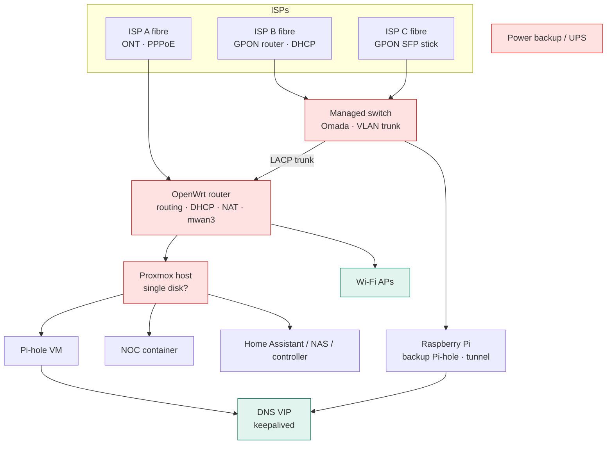
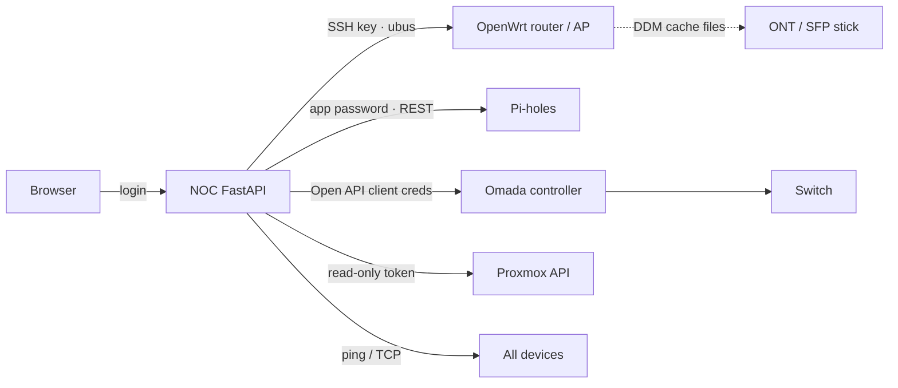

# Architecture

## Reference home-lab layout

Red = single point of failure, green = redundant.

## How the NOC connects

### Design rules
- **Preview → confirm for every write.** The backend builds the exact change, shows a
  human-readable diff, and only acts after confirmation. Protected items need their name
  typed; some changes are refused outright (LAG member ports, the LAG native VLAN, the
  built-in management network).
- **Read back after writing.** Switch VLAN changes are re-read from the controller and
  reported as an error if they don't match the preview.
- **Least privilege.** Proxmox token is PVEAuditor (read-only). The NOC has its own SSH key;
  no personal credentials are used.
- **Audit log.** Every action is appended to `/var/lib/noc/audit.jsonl` (who, when, what, result).
- **Config, not code.** Everything site-specific is in `config.json`; secrets in `secrets.env`.
- **Fail visibly.** A source that can't be read shows its error on the card; stale data is labelled stale.

## Single points of failure worth fixing first
| Item | Mitigation |
|---|---|
| Power | UPS/inverter in "UPS mode"; DC mini-UPS for router + ONT (no changeover gap) |
| Router | Config backups; a cold-standby OpenWrt VM |
| Switch carrying several ISPs | Plug at least one ISP directly into the router |
| Proxmox on one disk | Nightly vzdump backups to a NAS; mirrored disks later |
| Remote access on one box | Second `cloudflared` replica on another host (same token) |
| 2.4 GHz from one radio | Enable 2.4 GHz on a second AP |
